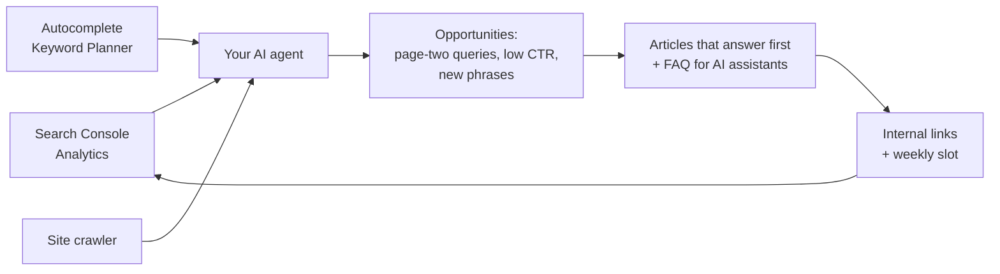

# zero-dollar-seo

**Your AI coding agent + Google's free data = an SEO engine. No Semrush, no Ahrefs, no per-search fees.**

Works with Claude Code · Codex · Cursor · Gemini CLI · GitHub Copilot · any agent that reads `AGENTS.md` or Agent Skills (`SKILL.md`).

---

Paid SEO tools cost $100+ a month, and even the free open-source ones buy their search data and charge you per search.
For **your own website**, the data that matters is already free, because Google gives it to you:

| What you need to know | Where it comes from (free) |
|---|---|
| Which searches bring people to your site, and where you rank | **Google Search Console** |
| What visitors do after they arrive, including visits from ChatGPT and other AI assistants | **Google Analytics 4** |
| What people search for that you don't show up for yet | **Google Autocomplete** + **Keyword Planner** |
| Broken links, orphan pages, missing titles and meta | the **crawler** in this repo |

This repo gives your AI agent the workflows, prompts and scripts to turn that data into a plan, and the plan into articles, every week.

## How it works



1. **Your agent reads your own data.** It sees your rankings, clicks and conversions, and which pages AI assistants send people to.
2. **It finds demand you don't capture yet.** Google Autocomplete runs A to Z for each of your topics. Every phrase you already appear for is removed, so what is left is new demand. Keyword Planner adds the search volumes.
3. **It writes, links and schedules.** Every two weeks it writes articles for those phrases:
   - each article opens with a direct answer, the format AI assistants quote, and ends with an FAQ
   - each one gets links from your existing pages
   - each one goes into a fixed weekly slot

## Quick start

You need **Python 3.10+**, a website, and a Google account that owns it in Search Console. The onboarding helps you verify the site if you haven't yet.

```bash
git clone https://github.com/krisuuu2/zero-dollar-seo
cd zero-dollar-seo
pip install -r requirements.txt
```

Then open the folder in your agent and start the onboarding:

| Agent | How to start |
|---|---|
| **Claude Code** | type `/seo-setup` |
| **Codex** | say "set up zero-dollar-seo" (reads `AGENTS.md` and the skill in `.agents/skills/`) |
| **Cursor** / **GitHub Copilot** | in the chat, say "set up zero-dollar-seo" (both read `AGENTS.md`) |
| **Gemini CLI** | say "set up zero-dollar-seo" (reads `GEMINI.md`, which imports `AGENTS.md`) |

The onboarding is a short interview. Your agent asks about your business and your customers, reads your website and proposes seed topics. Then it walks you click by click through giving it **read-only** access to Search Console and Analytics: a free Google Cloud service account, about 5 minutes. After that it runs everything:

- ✅ a **site audit** (`reports/audit.md`)
- ✅ a **baseline report**: your monthly trend, page-two queries, pages people see but don't click, AI-assistant traffic
- ✅ a list of **new keywords** you don't rank for yet, with volumes
- ✅ your **first article**, written to rank and to be quoted by AI assistants
- ✅ a **weekly publishing rhythm** (WordPress drafts or scheduling built in; any other CMS by copy-paste)

## Every two weeks

| Claude Code | Any other agent | What happens |
|---|---|---|
| `/seo-cycle` | "run the SEO cycle" | fresh data → quick title fixes → next articles → internal links → schedule → log |
| `/seo-audit` | "audit my site" | broken links, orphan pages, titles, meta, thin pages, noindex |
| `/seo-report` | "SEO report" | your progress in plain language, from your own Google data |

## What's inside

```
AGENTS.md                 shared instructions (Codex, Cursor, Copilot…); CLAUDE.md and GEMINI.md import it
.agents/skills/…          the Agent Skill (SKILL.md) for Codex, Gemini CLI, Copilot, Cursor
.claude/skills/… commands/ the same skill + slash commands for Claude Code
workflows/                setup · cycle · audit · report, step by step
prompts/                  choosing topics · writing for Google and AI answers · internal links · titles that get clicked
scripts/                  check_access · gsc_pull · ga4_pull · autocomplete_harvest · merge_volumes · crawl · wp_publish
config/site.example.json  everything about your business (filled in during onboarding)
```

You can also use the skill outside this folder: copy `.agents/skills/zero-dollar-seo` into your agent's skills folder (for example `~/.claude/skills/` or `~/.codex/skills/`). It will offer to clone this repo when you ask for help with SEO.

## What it is, and what it isn't

- **It is** your own data, used properly: rankings, clicks, conversions, AI-assistant traffic, new demand, technical health, and a steady writing rhythm.
- **It isn't** a backlink database or a spy tool for competitors' traffic. Those need paid data. For most small sites, what moves the needle is the work above, done every week.
- Your agent changes nothing on your live site without showing you the change and getting a yes.
- Your Google key and passwords stay in `secrets/` on your computer. They are ignored by git and never printed.

## Results that inspired this

On my own business, after running this rhythm:
- **Visits from ChatGPT and other AI assistants grew 13× in two months.**
- **Clicks from Google more than doubled in a year.**

No paid SEO tool was used. Your results will depend on your niche, your site and how consistently you publish.

---

Made by **Kris**: AI automations you can use today.
YouTube **[Kris | AI, Practically](https://www.youtube.com/@aipracticallykris)** · Instagram **[@aipractically](https://www.instagram.com/aipractically/)**.
Not affiliated with Google, Semrush, Ahrefs or OpenSEO. MIT licensed: use it, fork it, improve it. Pull requests are welcome.
